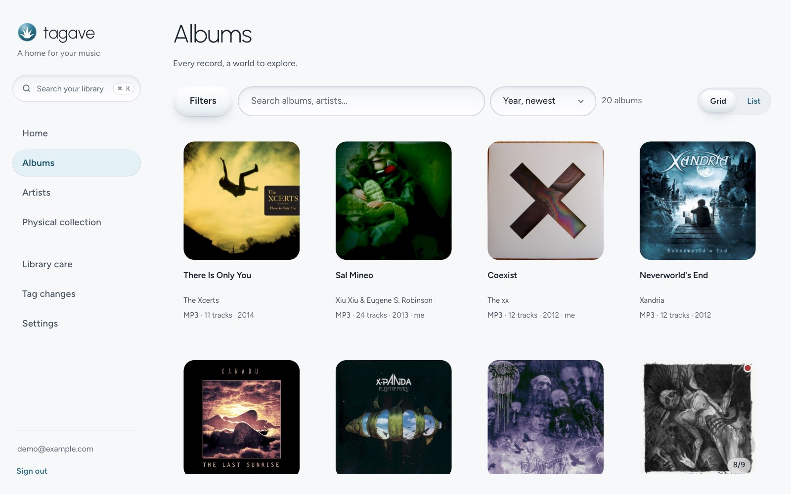

<div align="center">


# tagave

**A catalogue for a music collection you actually own.**

tagave identifies every album in your archive down to the pressing, corrects the
tags without ever damaging a file, and tells you what is missing.

It is a catalogue that also plays: an optional player module (a bundled
Navidrome, or your own Subsonic-compatible server) plays albums inside tagave
and serves your phone apps. Each person's plays become their listens and are
scrobbled to their own Last.fm and ListenBrainz.

</div>

<br />



<br />

## What it does

**Identifies what you own.** Every album is matched against MusicBrainz and
Discogs, and when the tags are wrong or missing it falls back to acoustic
fingerprinting of the audio itself. It cares which pressing: not just
*Liebe ist für alle da*, but the two-disc edition, with its catalogue number,
and it knows that the folders named CD1 and CD2 are one release.

**Corrects metadata without breaking anything.** Tag changes are proposed as a
plan, previewed file by file, applied, and reversible from a journal. A field
whose correct value is unknown is never blanked. Fields can be locked so nothing
overwrites a decision you made. Files are never converted, never split, never
deleted.

**Shared with the household.** Invite people from Settings › Users as
listeners (browse and play), editors (also library care and tag changes) or
owners. Ratings, reviews and listens stay each person's own.

**Tells you what is wrong or missing.** Incomplete albums, duplicates, missing
artwork, and gaps in the discography of artists you follow.

**Knows about the objects on your shelf.** Sync with a Discogs collection and
record which releases you own on vinyl or CD, so the files and the shelf are one
catalogue.

**Links to your other music apps.** With Music Connections, a critic-review
app such as review-gatherer can read your ratings, collection and listens, and
tagave shows its critic scores in your album's review panel and its suggestions
next to your wantlist. Each person links their own account in Settings ›
Connections, approves what is shared, and can revoke it at any time. Your
review text is never shared. Music Connections is off by default; the owner
turns it on in Settings › Modules. [Operations](docs/operations.md#music-connections)
explains how.

**Keeps your account yours.** Sign in with a passkey or a security key such as a
YubiKey, add an authenticator app with backup codes, and see and revoke the
devices you trusted. [Security](docs/security.md) has the details.

## Quick start

You need Docker and Compose v2. One command installs it from the published images:

```sh
bash -c "$(curl -fsSL https://raw.githubusercontent.com/xooxoxxo/tagave/main/install-tagave.sh)"
```

Then open <http://localhost:3100> and follow the setup. From a clone,
`./install-tagave.sh` does the same. [Installation](docs/install.md) covers the
options, including a file worker on the computer that holds your music.

To build from source instead:

```sh
cp .env.example .env
openssl rand -hex 32                 # paste this as APP_SECRET
$EDITOR .env                         # set PUBLIC_URL, and uncomment MUSIC_DIR and point it at your library
docker compose -f docker-compose.prod.yml --profile workers up -d
```

Then open <http://localhost:3100> and follow the setup.

One thing worth knowing before you start: scanning and tag writing happen in a
worker process that has to see your files, which is why `MUSIC_DIR` matters and
why a scan root stays `pending` until a worker is running. [Installation](docs/install.md)
explains the two ways to arrange that.

## Documentation

| | |
|---|---|
| [Installation](docs/install.md) | Getting it running, connecting it to your music, and the optional player |
| [Features](docs/features.md) | What the app does, in more detail |
| [Tag correction](docs/tag-correction.md) | How writes work, and what stops them going wrong |
| [Operations](docs/operations.md) | Backups, upgrades, health checks, moving workers |
| [Security](docs/security.md) | `APP_SECRET`, rotation, TLS, Music Connections |
| [Architecture](docs/architecture.md) | How the pieces fit, and how to develop on it |
| [Design system](docs/design/system.md) | Visual language and component contracts |

## Status

Early. It runs a real library of about 27,000 albums and 240,000 files every
day, but it has one user, so expect rough edges and read
[Operations](docs/operations.md) before trusting it with anything you cannot
re-rip.

## Licence

[AGPL-3.0](LICENSE). The tag writer runs [mutagen](https://github.com/quodlibet/mutagen)
as a separate process; see [THIRD-PARTY-NOTICES.md](THIRD-PARTY-NOTICES.md).

Metadata comes from [MusicBrainz](https://musicbrainz.org) and
[Discogs](https://www.discogs.com). tagave uses the Discogs API but is not
affiliated with, sponsored or endorsed by Discogs. Discogs is a trademark of
Zink Media, LLC.
